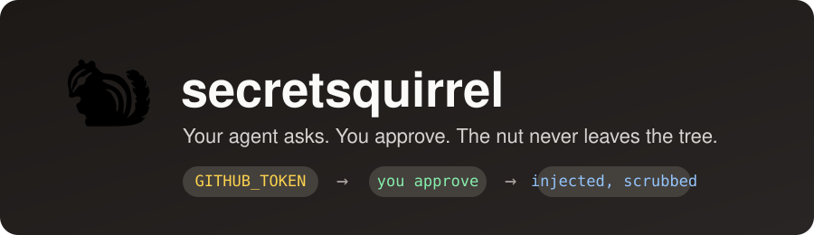
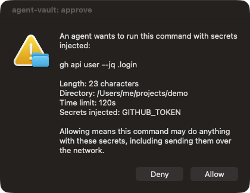
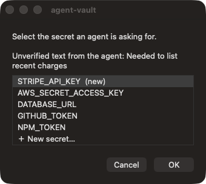
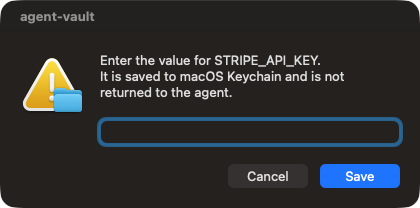
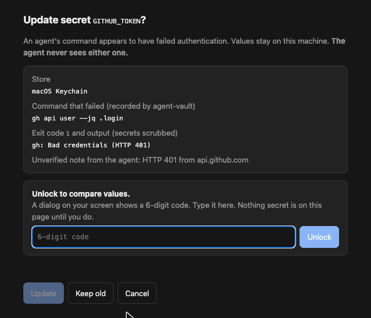
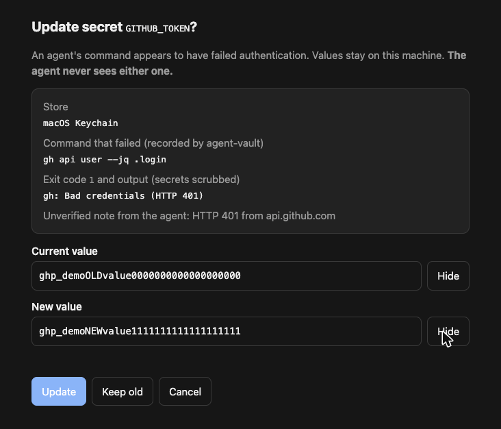

<p align="center"></p>

# secretsquirrel (agent-vault)

Lets Claude Code and Cursor agents use passwords and API keys **without seeing them**.
The agent names environment variables (`GITHUB_TOKEN`); you approve the exact command in a native popup; the value comes from your existing password store and is injected into that one process. Nothing is stored by agent-vault itself.

## Install in one line

Paste this into Claude Code or Cursor:

```text
Set up secretsquirrel so you never need my passwords in chat: ask me which password store and which agents (Claude Code, Cursor) I want, then run `npx -y secretsquirrel init --store <store> --agents <list> --yes`, and tell me to restart you.
```

Or run it yourself (interactive: it shows each store with how many entries it already holds, and asks which agents to wire up):

```bash
npx secretsquirrel init
npx secretsquirrel uninstall   # restores every config file it touched
```

## What it looks like

When an agent wants to use a secret, it names an env var. You see the whole command first:

<p align="center"></p>

If the secret isn't stored yet, you pick or name it (the agent's suggestion comes pre-filled, plus your existing keys), then type the value into a hidden field. The agent never sees it:

<p align="center">
  
  &nbsp;
  
</p>

If a run looks like a failed login, the agent can ask to replace the secret, but only you decide. A local page shows what failed and stays locked until you type a 6-digit code that appears in a separate native dialog:

<p align="center"></p>

Then you compare old and new values side by side (hidden until you reveal them). The agent only learns "updated", "declined" or "cancelled":

<p align="center"></p>

_Screenshots use dummy values._


macOS only for now (native dialogs use `osascript`). Node 20+.

## Stores
macOS Keychain, 1Password (`op`), Bitwarden (`bw`/`bws`), `pass`/`gopass`. `init` shows how many entries each already holds.

## What the agent gets
| Tool | Purpose |
|---|---|
| `list_secrets` | Names only |
| `run_with_secrets` | Run a command with named env vars; you approve it first; output is scrubbed |
| `request_secret` | Ask you to store a secret (private popup) |
| `update_secret` | After a suspected auth failure, you compare old and new values behind a 6-digit on-screen code; the agent only learns updated / declined / cancelled |

A guard hook (Claude Code `PreToolUse`, Cursor `beforeShellExecution`) blocks direct reads of password stores, env dumps and `echo $TOKEN`, and fails closed. A bundled skill teaches the agent the flow.

## Config (`~/.config/agent-vault/config.json`)
```json
{ "defaultBackend": "1password",
  "allow": { "GITHUB_TOKEN": ["gh", "git"], "AWS_*": ["aws"] },
  "approvalTtlMinutes": 10 }
```
`allow` restricts which programs may receive a secret. Identical, already-approved commands skip re-approval for the TTL (0 disables).

## Limits: read these
- **Approval is the control.** An approved command can send its secrets anywhere. The allowlist and guard hook narrow the easy routes; they are text matches, not a sandbox.
- **Keychain does not isolate other processes.** Items are readable by `security` without a prompt, so anything running as you can read them. Prefer 1Password or Bitwarden, which require their own unlock.
- **Accessibility permission** granted to your terminal lets an agent script clicks on the "Allow" dialog. The hook blocks obvious `osascript`/`cliclick` use but can be bypassed.
- **Redaction is best effort.** It handles plain, JSON, URL, hex, base64 forms and withholds output on spaced/reversed/case-swapped leaks, but cannot catch arbitrary transforms or yes/no probing.
- **A secret pasted in chat** is already exposed; rotate it.
- **Cursor is untested.** MCP and hook config are written per Cursor's docs, but `cursor-agent` and hook execution were not verified, and 1Password/Bitwarden/`bws` were tested against stubs only. If Cursor CLI ignores hooks, the MCP tools still work but the guard does not.
- Every action is logged (names and outcomes, never values) to `~/.config/agent-vault/audit.log`.

## Development
`npm run build && npm test`. Set `AGENT_VAULT_CONFIG` / `AGENT_VAULT_AUDIT` to redirect state.
